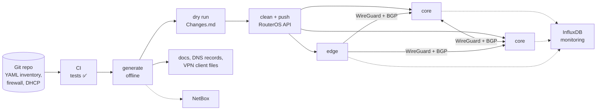

# mikro-sdn

[](https://github.com/luismiparra/mikro-sdn/actions/workflows/tests.yml)


[](LICENSE)

**Network as code for multi-site MikroTik networks: one YAML inventory in Git becomes a routed
WireGuard + BGP backbone, VLANs, firewall and VPNs on every router.**

You describe every router once: its role, its site, VLANs, VPNs and firewall policy. mikro-sdn
generates the complete RouterOS 7 configuration of every device, shows you exactly what would
change, and applies it through the RouterOS API. Anything on a router that the repository doesn't
describe is removed, so Git stays the single source of truth.

## Why I built it

I run a real multi-site network on MikroTik routers, joined by an encrypted backbone, and
configuring each router by hand stopped scaling quickly. Every new site meant tunnels on both
ends, routing filters, firewall rules and addresses to keep consistent, and every manual change
was a chance to break something.

mikro-sdn is how that network has been run **in production since 2022**: change YAML, review the
diff, push. This repository is the open-source edition, with a fictitious lab network instead of
the real one, so anyone can try it, learn from it or reuse it.

## Highlights

- **Declarative and idempotent.** The repository is the desired state. A push converges each
  router to it, and a second push changes nothing.
- **Zero-touch WAN mesh.** Every core is meshed with every other core, and every edge connects to
  every core, over WireGuard with eBGP (IPv4 + IPv6), BFD and AS-path traffic engineering. Keys,
  ports and transit addresses are generated **deterministically**, so adding a site never
  renumbers an existing link.
- **Addressing from three prefixes per site.** VLAN gateways, DHCP pools, VPN ranges, transit
  links and loopbacks are all derived from one `/16`, one `/96` and one `/53`.
- **Safe by design.** Offline generation, dry runs with a human-readable change log, protected
  comment prefixes for anything managed by hand, and per-device push/clean switches.
- **GitOps-ready.** A commit drives the change: CI runs the tests and only then pushes to the
  routers, with readable logs and summary tables in the job page.
- **Tested without hardware.** 356 unit and functional tests run against in-memory RouterOS and
  NetBox doubles, with a 95% coverage gate (currently 99%).
- **Self-documenting.** Every run produces per-router configuration pages, DNS records and a change
  log.



## What it builds

| Area | What you get |
|------|--------------|
| **WAN fabric** | Full WireGuard mesh between *core* routers, a link from every *edge* to every core, eBGP (IPv4/IPv6), BFD, AS-path traffic engineering, per-site route filters, DDNS-aware endpoints. |
| **LAN** | VLAN-filtering bridge, VLAN interfaces, access/trunk ports, an isolated native VLAN, IPv4/IPv6 gateways, SLAAC, DHCP servers and pools, static leases, extra service IPs. |
| **L2 extension** | Optional VXLAN between sites over the WireGuard fabric, bridged into local VLANs. |
| **Remote access** | WireGuard VPN servers per site (management, admin and user profiles) with generated client `.conf` files and QR codes, and an onboarding script for new routers. |
| **Firewall** | IPv4/IPv6 filter, NAT, mangle rules and address lists from YAML, with explicit ordering, merged with the rules the automation needs. |
| **Internet** | Per-host policy routing through another site's exit, automatic failover with netwatch, DNS fallback. |
| **Operations** | Netwatch probes, housekeeping schedulers, optional MQTT RTT metrics, RADIUS (user-manager), legacy WiFi. |
| **Ecosystem (optional)** | InfluxDB monitoring collector, a small self-service web portal, NetBox (DCIM/IPAM) sync, external Linux peers with WireGuard + FRR. |

## Quick start (offline, 5 minutes)

This generates the configuration of the bundled 6-router lab **without touching any router**.

```bash
git clone https://github.com/luismiparra/mikro-sdn.git && cd mikro-sdn

# 1. System dependency: WireGuard tools (key generation)
#    macOS: brew install wireguard-tools     Debian/Ubuntu: sudo apt install wireguard-tools

# 2. Python 3.10+ dependencies
python3 -m venv .venv && .venv/bin/pip install -r requirements.txt

# 3. Settings and private files
cp .env.example .env
cp -r secrets.example secrets

# 4. Generate (control/control.yml ships with mode: config, which never connects to a device)
.venv/bin/python 1-mikro-auto/mikro_main.py
```

```
⚙️ GENERAL        │ Generated config
                  │ ┌────────────┬──────┬─────────┬────────────┬──────────┬─────┬────┬──────────┬───────────────┬────────┬─────┬──────┬──────┐
                  │ │ Device     │ Role │ general │ autoupdate │ internet │ wan │ fw │ netwatch │ radius_server │ wg_vpn │ lan │ dhcp │ wifi │
                  │ ├────────────┼──────┼─────────┼────────────┼──────────┼─────┼────┼──────────┼───────────────┼────────┼─────┼──────┼──────┤
                  │ │ lab-mikro1 │ core │ ✅      │ ✅         │ ✅       │ ✅  │ ✅ │ ✅       │ ✅            │ ✅     │ ✅  │ ✅   │ ·    │
                  │ │ lab-mikro2 │ core │ ✅      │ ✅         │ ✅       │ ✅  │ ✅ │ ✅       │ ·             │ ·      │ ✅  │ ✅   │ ·    │
                  │ │ lab-mikro4 │ edge │ ✅      │ ✅         │ ✅       │ ✅  │ ✅ │ ✅       │ ·             │ ·      │ ✅  │ ✅   │ ·    │
                  │ │ …          │      │         │            │          │     │    │          │               │        │     │      │      │
                  │ └────────────┴──────┴─────────┴────────────┴──────────┴─────┴────┴──────────┴───────────────┴────────┴─────┴──────┴──────┘
```

Then look at:

- `web/lab-mikro1.html`: the full generated configuration of one router, as tables
  ([sample](examples/generated-output/lab-mikro1.md)).
- `secrets/proposed/lab-mikro1_global.yml` and `_fw.yml`: exactly what would be pushed.
- `.venv/bin/python 1-mikro-auto/mikro_ports.py`: the WireGuard port and transit-IP plan of the
  mesh.

Continue with **[Getting started](docs/getting-started.md)** to prepare a router and do a first
dry run and push.

> [!WARNING]
> mikro-sdn is opinionated and **authoritative**: a real push removes objects in the managed
> RouterOS paths that the repository doesn't describe, unless their comment carries one of your
> protected prefixes. On a router that is already in use, that includes your WAN address, default
> route and firewall rules. Start in a lab and read the [safety model](docs/concepts.md#safety-model)
> first.

## Documentation

| | |
|---|---|
| **[Getting started](docs/getting-started.md)** | Install, first offline run, preparing routers, dry run, first push. |
| **[Concepts](docs/concepts.md)** | Roles, configlets, the generate → clean → push cycle, the safety model. |
| **[Network design](docs/network-design.md)** | Addressing plan, WireGuard mesh, BGP policy, VXLAN, internet transit. |
| **[Inventory reference](docs/configuration/inventory.md)** | Every field of a device, VPN, LAN and VLAN. |
| **[Config files](docs/configuration/config-files.md)** | Firewall, general, DHCP and clean-routes files, rule ordering. |
| **[Environment and control](docs/configuration/environment.md)** | Every environment variable and `control.yml`. |
| **[Configlets](docs/configlets.md)** | What each configlet creates on the router. |
| **[Secrets and outputs](docs/secrets-and-outputs.md)** | Generated keys, proposed config, docs, VPN files, backups. |
| **[Operations](docs/operations.md)** | Day-2 tasks: add or remove a site, push one device, onboarding, boot hook. |
| **[Tools](docs/tools/)** | [Monitoring](docs/tools/monitoring.md), [web portal](docs/tools/web-portal.md), [NetBox](docs/tools/netbox.md), [external Linux peers](docs/tools/external-peers.md). |
| **[CI/CD (GitOps)](docs/ci-cd.md)** | Running pushes from GitHub Actions, CI log format. |
| **[Security](docs/security.md)** | Trust model, known weaknesses, hardening. |
| **[Testing](docs/testing.md)** | Test suite, test doubles, known bugs. |
| **[Troubleshooting](docs/troubleshooting.md)** | Common errors and what they mean. |

## Repository layout

| Path | Content |
|------|---------|
| [`1-mikro-auto/`](1-mikro-auto/) | The automation engine (`mikro_main.py` is the entry point). |
| [`2-mikro-monitoring/`](2-mikro-monitoring/) | Collects WireGuard, DHCP, netwatch and RADIUS metrics into InfluxDB. |
| [`3-mikro-webportal/`](3-mikro-webportal/) | Flask portal: per-user DNS filter/VPN toggles and the router boot hook. |
| [`4-netbox/`](4-netbox/) | Syncs sites, devices, VLANs, prefixes and IPs into NetBox. |
| [`config/`](config/) | A complete fictitious lab: 3 cores, 3 edges and 2 external Linux peers. Start from here. |
| [`control/control.yml`](control/control.yml) | Run switch, mode (`config` / `firewall` / `global`) and dry run. Ships in safe mode. |
| [`secrets.example/`](secrets.example/) | Templates of the private files (RADIUS users, WiFi). |
| [`templates/`](templates/) | Jinja2 templates of the generated pages and the onboarding script. |
| [`examples/generated-output/`](examples/generated-output/) | What the generator writes for the lab. |
| [`docs/`](docs/) | The documentation. |
| [`tests/`](tests/) | Unit and functional tests (no real devices needed). |

## Requirements

- Python **3.10+** (tested on 3.12) and `wireguard-tools` (`wg`) on the machine that runs it.
- MikroTik routers on **RouterOS 7** (7.15 – 7.20), reachable over **API-SSL (8729)**. The
  monitoring tool and the web portal also use the REST API (HTTPS).
- Optional: InfluxDB 2.x, NetBox, an MQTT broker, Linux hosts with FRR for external peers.

## Project status

The engine runs a real production network every day. It's also opinionated: it assumes a specific
design (a `/16` per site in `10.0.0.0/8`, a fixed VLAN layout, WireGuard everywhere), and it has
known rough edges, documented openly in [known bugs](docs/testing.md#known-bugs) and
[security](docs/security.md). Issues, ideas and pull requests are welcome, see
[CONTRIBUTING](CONTRIBUTING.md).

## Author

Built and maintained by **Luis Miguel Parra** ([GitHub](https://github.com/luismiparra)).
If you use it, find it useful or want to talk about network automation, I'd love to hear from you.

## License

[Apache License 2.0](LICENSE).
