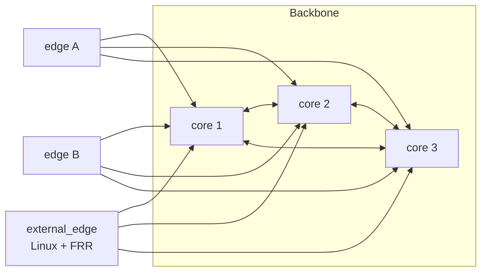
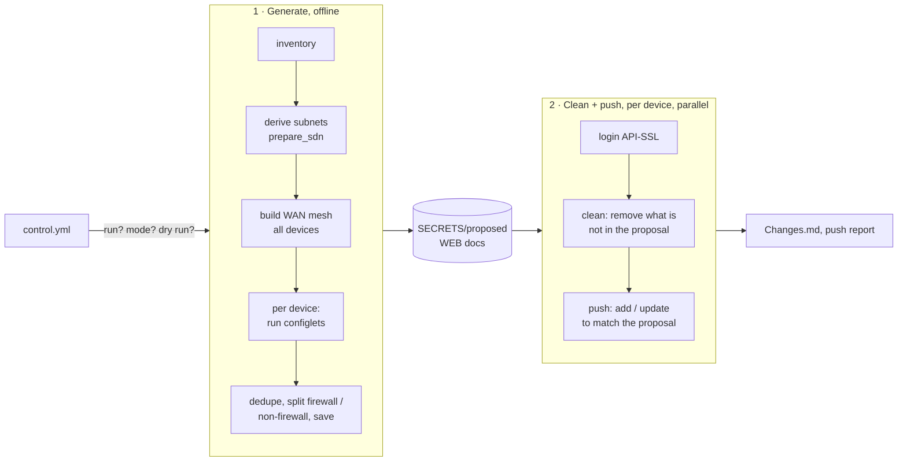

# Concepts

This page explains how mikro-sdn thinks: what a device is, how configuration is produced, how it
reaches the router and what is protected. Read it before your first push.

- [Roles](#roles)
- [Configlets](#configlets)
- [The run: generate → clean → push](#the-run-generate--clean--push)
- [Identity: the comment is the key](#identity-the-comment-is-the-key)
- [Safety model](#safety-model)
- [Modes, dry run and single-device runs](#modes-dry-run-and-single-device-runs)
- [Glossary](#glossary)

---

## Roles

Every device in the inventory has a `role`, which is also the top-level key of its inventory file:

| Role | What it is | Gets config from the automation |
|------|------------|---------------------------------|
| `core` | A backbone router with a public, reachable endpoint. Cores form a **full WireGuard mesh** with each other and accept links from every edge and external peer. They can act as internet transit for others. | Yes |
| `edge` | A branch router. It builds one WireGuard link **to every core** (not to other edges) and only advertises its own site. Edges can sit behind NAT or a dynamic IP. | Yes |
| `external_edge` | A non-MikroTik host (Linux with WireGuard + FRR, e.g. a VPS or a server) that joins the BGP fabric. | No: the cores get their side of the link, and ready-made WireGuard and FRR files are written for the host, see [external peers](tools/external-peers.md). |



Each line is a WireGuard tunnel carrying an eBGP session for IPv4 and one for IPv6. Details:
[Network design](network-design.md).

## Configlets

A **configlet** is one feature module. A device's `configlet` list decides which modules generate
config for it, so you can enable features per device:

| Configlet | Generates |
|-----------|-----------|
| `general` | The static baseline from `config/general/<role>/` (services, SNMP, NTP, logging, BFD…). |
| `fw` | Firewall from `config/firewall/global/` + `config/firewall/<device>/`. |
| `lan` | Bridge, VLANs, ports, gateways, DHCP servers, pools, VXLAN. |
| `dhcp` | Static DHCP leases from `config/dhcp/ipv4/<device>/`. |
| `wan` | The WireGuard + BGP fabric (links, filters, BFD, DDNS updaters). |
| `wg_vpn` | WireGuard remote-access VPN servers and client files. |
| `internet` | Internet routing table, policy routing, core-transit failover. |
| `netwatch` | DNS fallback and internet probes (optional MQTT RTT metrics). |
| `autoupdate` | Housekeeping schedulers (RouterOS updates, WireGuard re-enable, optional boot hook and watchdog). |
| `radius_server` | RouterOS user-manager users and RADIUS clients. |
| `wifi` | Legacy `/interface/wireless` interfaces, security profiles, RADIUS, MAC ACL (requires `lan`). |

Each one is described in detail in [Configlets](configlets.md). Some configlets also add firewall
rules they need (e.g. `wan` opens the WireGuard ports), so `fw` is not the only source of firewall
rules.

## The run: generate → clean → push



1. **Generate** (always offline). The inventory is loaded and every device's subnets are derived.
   The WAN mesh is computed for *all* devices at once, because both ends of a link must agree.
   Then each enabled configlet produces a list of RouterOS objects for the device. The result is
   de-duplicated by comment, split into a firewall list and a general list, and saved to
   `SECRETS/proposed/<device>_fw.json|yml` and `_global.json|yml`. The previous proposal moves to
   `old_proposed/`. Documentation pages are written to `WEB/`.
2. **Clean** (per device). The automation logs in and removes objects that are on the router but
   not in the proposal, following the [safety model](#safety-model).
3. **Push** (per device). For each object in the proposal: if an object with the same comment
   exists and any field differs, it's updated; if none exists, it's added. Firewall rules are then
   placed in order (`top`, `bot`, `posi`), see [config files](configuration/config-files.md#rule-order).

Devices are processed in parallel (up to 30 at a time). A device that can't be reached, or an
object the router rejects, is logged and counted in the push report while the others continue.
An unexpected exception while processing a device stops the run (`errorStop`; with `DEBUGMODE`
set it waits for Enter instead).

Pushing is **idempotent**: a second run against a converged router changes nothing.

## Identity: the comment is the key

RouterOS objects have no stable name you can rely on, so mikro-sdn identifies them by
**comment**. Every generated object carries a unique comment (`vlan_1safe`, `ip_1safe_10.21.1.1`,
`bgp_v4_lab-mikro1_main__lab-mikro4_main`, …). That's how the automation knows an object is "its
own", compares it field by field and updates it in place.

Consequences:

- **Don't edit generated objects on the router.** The next push reverts the change.
- **Don't rename comments** of objects you want to keep: a different comment is a different object.
- Settings that are singletons in RouterOS (`/ip/dns`, `/snmp`, `/system/clock`, …) or objects
  addressed by name (`/ip/service`) don't use comments. They're written with `use_set: true` and
  simply set on every push.
- Comments must be unique per path. When two config items share a comment, the first one wins and
  a warning is logged.

## Safety model

The clean step is what makes the repository authoritative, and it's the dangerous part.

### What is removed

In every path listed in [`clean_routes.yml`](configuration/config-files.md#clean_routesyml)
(interfaces, bridges, VLANs, addresses, pools, DHCP, WireGuard, schedulers, routing tables,
rules, routes, BGP, netwatch, RADIUS, wireless, …) and in the firewall (`filter`, `nat`, `mangle`
and `address-list`, IPv4 and IPv6), an object is **removed** when:

- it has **no comment**, or
- its comment is **not in the proposal for this device**,

**unless** one of these is true:

- its comment **contains** one of the `LOCALSTRING` values (default `local_auto_`, `auto_webapp_`),
- it's a RouterOS **default**, **built-in** or **dynamic** object, or has a **default-name**
  (physical interfaces, default routing table…).

> [!CAUTION]
> In the firewall **address lists**, entries without a comment are removed even when they're
> dynamic. Lists filled at runtime by `add-src-to-address-list` rules (port-scan bans, etc.) are
> therefore emptied on every push. Give such entries a protected comment, or accept the reset.

Objects outside those paths (users, certificates, DHCP clients, system settings, packages) are
never removed. Singleton settings are only set.

### `LOCALSTRING`: protected prefixes

`LOCALSTRING` is a JSON list in `.env`, e.g. `'["local_auto_", "auto_webapp_"]'`:

- Anything whose comment contains one of them survives the clean step. Use it for everything you
  manage by hand: WAN address, default route, port forwards made outside the repo, emergency
  access rules.
- The **first** value is also the prefix the automation itself puts on the **management VPN**
  objects (`wg_vpn` with `mgmt_vpn: true`). Those objects then survive a push from a config that
  no longer contains them, so you can't cut your own management path by mistake.
- Keep `auto_webapp_` in the list if you use the [web portal](tools/web-portal.md): it's the
  prefix of the address-list entries the portal creates.

### Per-device switches

| Inventory field | Effect |
|-----------------|--------|
| `push_config: false` | Never write to this device (it's still generated and documented). |
| `push_clean: false` | Never remove from this device; only add and update. A good setting while onboarding. |
| `clean_config: true` | **Wipe**: push an empty config, so the clean step removes everything removable from the device. For decommissioning. |
| `enabled: false` | Leave the device out of the WAN mesh, the port report and monitoring. It still gets generated. |

### Locking yourself out

The firewall shipped in `config/firewall/global/` only accepts management traffic (API, SSH,
WinBox, HTTPS) from the address list **`ACL4_HOSTS_MGMT`** and from the management VPN.
Before the first firewall push, make sure the address the automation connects from is in that
list, or in a `LOCALSTRING`-protected rule.

## Modes, dry run and single-device runs

`control/control.yml` decides what a run does:

| `mikro_auto_mode` | Generate | Connects | Cleans / pushes |
|-------------------|:--------:|:--------:|-----------------|
| `config` | ✅ | ❌ | nothing (offline) |
| `firewall` | ✅ | ✅ | firewall only (filter, NAT, mangle, address lists) |
| `global` | ✅ | ✅ | everything |

With `mikro_auto_dry_run: true` the run connects and reads but never writes. Every add, update and
remove it *would* do is listed in `WEB/Changes.md` with secrets masked. `run_1_mikro_auto: false`
disables scheduled runs (CI, cron); a run for a named device still works.

Single-device runs:

```bash
python 1-mikro-auto/mikro_main.py lab-mikro4          # generate all, clean + push only lab-mikro4
TARGET_DEVICE=lab-mikro4 python 1-mikro-auto/mikro_main.py   # same, from the environment (CI)
python 1-mikro-auto/mikro_main.py lab-mikro4 aux      # connect to the device's `mgmt_aux` address instead
```

A single-device run still generates the whole network (links need both ends) but only connects
to that device, and doesn't rewrite the `WEB/` change log.

## Glossary

| Term | Meaning |
|------|---------|
| **Configlet** | A feature module enabled per device in the inventory's `configlet` list. |
| **Proposal** | The generated config of a device: `SECRETS/proposed/<device>_global` and `_fw`. |
| **Clean / push** | Remove what is not in the proposal / add and update what is. |
| **`LOCALSTRING`** | Comment substrings that protect objects from removal. |
| **`use_set`** | An item that is *set* (singleton or by name) instead of added/removed by comment. |
| **WAN / main** | The WireGuard + BGP backbone between routers (`int_w_<a>_main_to_<b>_main`). |
| **WG VPN** | The remote-access WireGuard servers for people (`int_w_vpn_<name>`). |
| **Slot / `wan_order`** | A device's fixed position in the mesh; it decides ports and transit subnets. |
| **Transit** | The `/30` (IPv4) and `/127` (IPv6) point-to-point subnets of WAN links. |
| **Core transit** | A core that other sites can send internet traffic through. |
